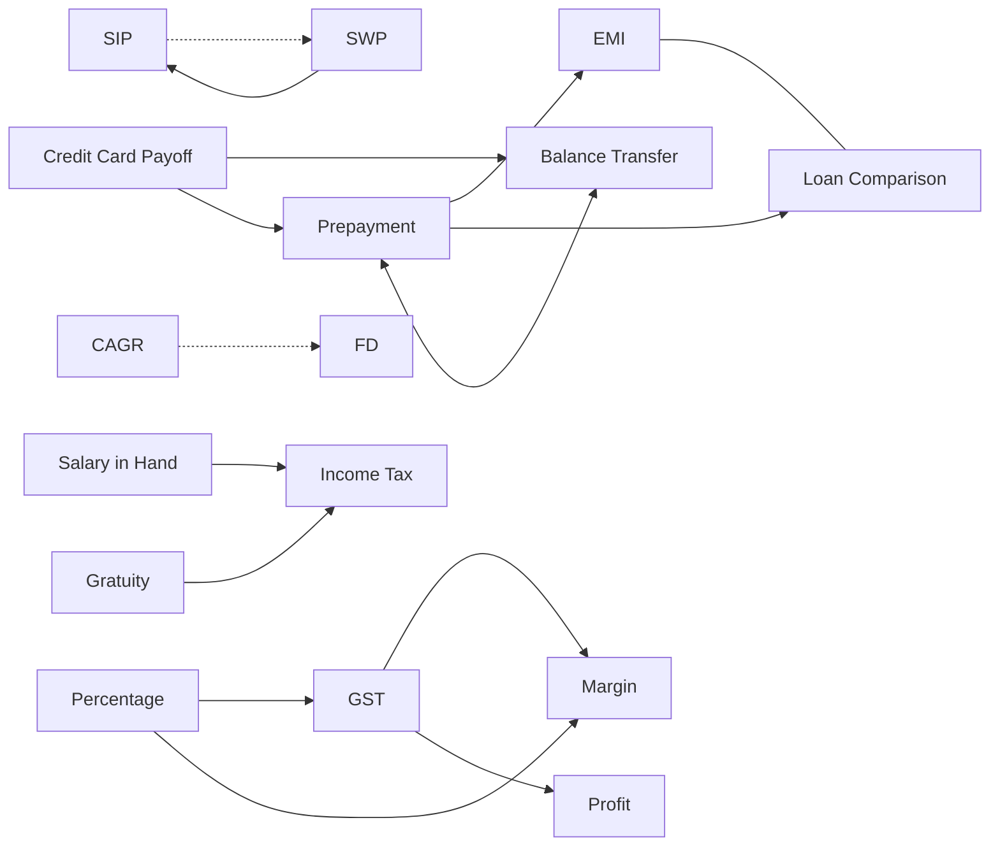
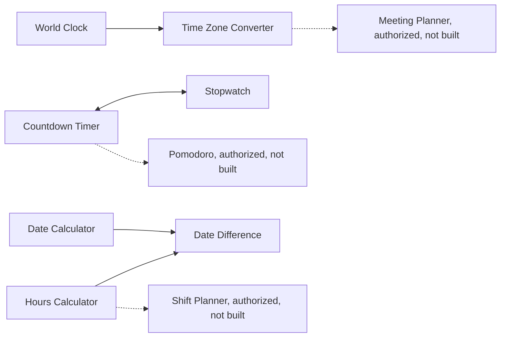
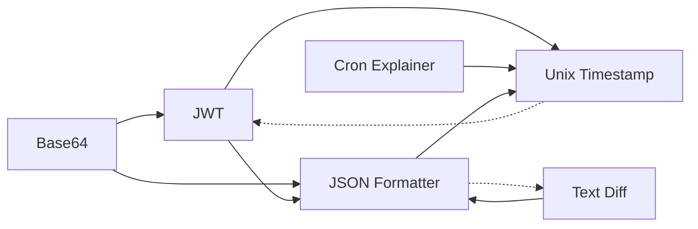

# 10. User journey maps

Journeys are grouped as **EXISTING WORKING**, **PARTIALLY SUPPORTED** or **PROPOSED**. "Existing" means the links exist in the catalog or module text; whether a visitor sees them on a real device was not walked here. Edges drawn with a dashed line do not exist today. Every proposed edge stays inside one section unless a decision in 14 says otherwise.

## Legend for the diagrams

Solid arrow: a link or curated relation that exists. Dashed arrow: proposed. Grey node: not built.

## Calculators



(EMI and Loan Comparison have no curated list; the first edge reflects category fallback, not a catalog relation. Verify before relying on it.)

| Journey | Entry intent | First output | Next question | Next step | Gap | Class | Priority / risk |
|---|---|---|---|---|---|---|---|
| Pay a loan down | "Can I save by prepaying?" | Interest saved | "Is moving the loan cheaper?" | Balance Transfer, with guides 15 and 16 | none | EXISTING | n/a |
| Save then draw down | "How much will my SIP grow?" | Projected value | "How long would it last as withdrawals?" | SWP | SIP does not point to SWP | PARTIAL | Medium, low risk (C1) |
| Compare two investments | "Which grew faster?" | CAGR | "What would a deposit give?" | FD | no curated link | PARTIAL | Low |
| Pay in hand | "What do I keep?" | In-hand salary | "How is tax computed?" | Income Tax | none | EXISTING (release gated) | n/a |

## Time Tools



| Journey | Class | Gap |
|---|---|---|
| Find the time elsewhere, then convert, then find a meeting time | EXISTING (World Clock to the converter, which has a meeting-overlap section) | The converter does not link back; the multi-person planner is authorized but not built |
| Time something | EXISTING | none |
| Dates | PARTIAL | one-way links |

## Developer Tools



Debug a token (JWT, then timestamps) and inspect a payload (Base64, then JSON) are EXISTING. JSON to Text Diff is PARTIAL. No automatic transfer of tokens or text between tools is proposed.

## Image Tools and PDF Tools

```mermaid
flowchart LR
  IC[Image Compressor] -.-> P2P[Photos to PDF]
  P2P --> IC
  M[Merge PDF] <--> SP[Split PDF]
  M <--> PG[Extract / Reorder / Rotate]
  SP <--> PG
  P2P -. text only, rule 4.2 .-> M
```

| Journey | Class | Gap |
|---|---|---|
| Combine PDFs and fix order | EXISTING | none |
| Split a large file, keep needed pages | EXISTING | none |
| Prepare photos, make a PDF | PARTIAL | compressor does not point to Photos to PDF; neither page renders related tools |
| Photos to PDF, then merge with other PDFs | PROPOSED | cross-section; requires the decision in 14, P3 (D5) |

## Cross-ecosystem observation

The only repeated multi-section need seen in the data is photos to PDF to merge (Image Tools to PDF Tools) and, weakly, cron or JWT to a time converter (Developer Tools to Time Tools). Neither justifies a site-wide sidebar. Nothing in the evidence shows users get trapped; the dead end is the absence of any visible "next" on 21 tool pages (N1).
