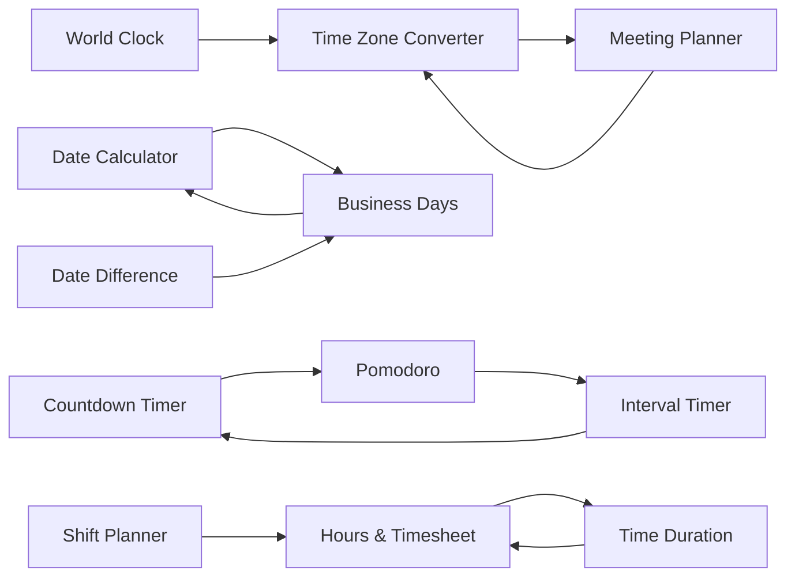

# 10. Ecosystem user journeys

Links are proposed only where the same user's next need overlaps, and only **inside Time Tools** (rulebook 4.2). A body-text mention outside the section waits for the owner's pending decision (`../14-...`, P3). The related-tools display is not built (`../08-...`, N1); until it is, "link" means a sentence of body text or a curated catalog relation that is not yet displayed. No sidebar.

| Journey | Entry question | First tool | Output | Next need | Optional next | Guide | Goal reached |
|---|---|---|---|---|---|---|---|
| Global collaboration | "What time is it for my team?" | World Clock | Live times in cities | "When can we all meet next week?" | Meeting Planner (via the converter) | DST mistakes in global meetings | A meeting time with everyone's local times copied |
| One-off conversion | "What is 3pm London in Tokyo on 10 March?" | Time Zone Converter | Converted times, DST notes | "Can the others attend?" | Meeting Planner | DST guide | A confirmed slot |
| Deadlines | "What date is 10 business days from today?" | Business Days | Result date and the convention | "How many calendar days is that?" | Date Difference | Business days vs calendar days | A deadline date |
| Calendar arithmetic | "What date is 90 days from today?" | Date Calculator | Result and weekday | "Is that a working day?" | Business Days | | A date |
| Focus | "I need to study in blocks" | Pomodoro | Cycles and phase cues | "I need a different rhythm" | Interval Timer | Pomodoro vs a basic timer | A completed session |
| Workout or routine | "Tabata for 4 minutes" | Interval Timer | Staged countdown | "Just a single timer" | Countdown Timer | | A finished routine |
| Work hours | "How many hours did I work this week?" | Hours & Timesheet | Totals | "Add these two lengths" | Time Duration | Counting overnight hours | A total to type into a timesheet |
| Shifts | "Show my 4-on-4-off calendar" | Shift Planner | Calendar and summary | "How many hours is that?" | Hours & Timesheet | | A printed schedule |

## Evidence status

The Time Zone Converter to Meeting Planner and Business Days to Date Difference links are REASONED PROPOSALS from tool specs and competitor offerings; no usage data shows people make these moves. Journeys that exist today are limited to the links in `../04-TIME-TOOLS-ECOSYSTEM.md`.

## What the journeys do not do

No engagement loops, no streaks, no accounts, no forced next step. Every journey ends when the task is done.
